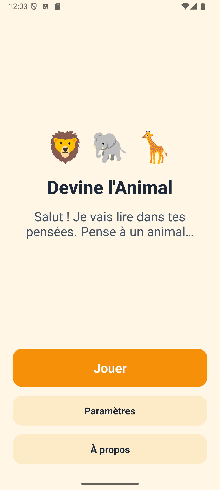
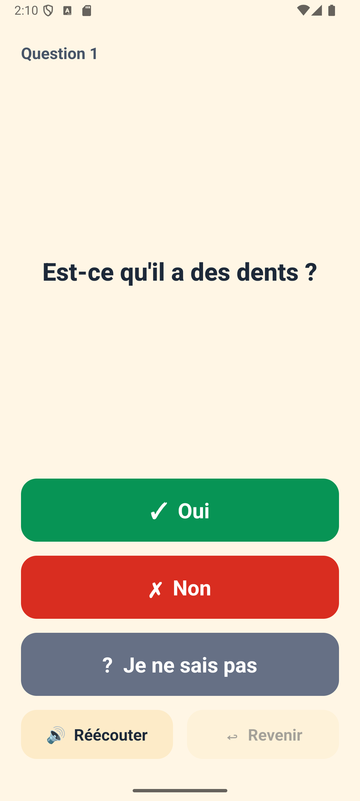
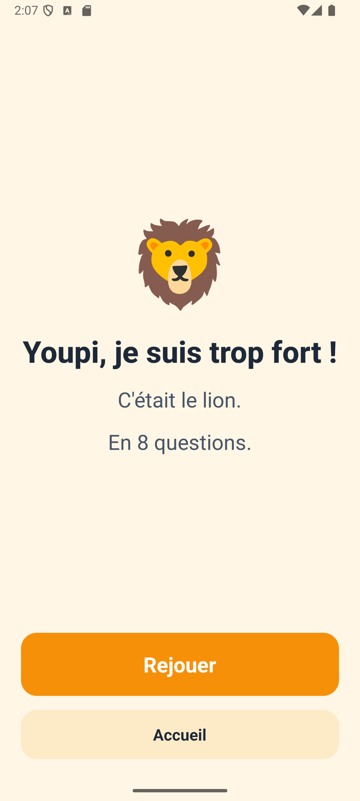

# Devine l'Animal

A small Android family guessing game made with React Native: think of an animal among about 150, the game asks
yes/no questions (shown and read aloud) until it finds it. The game is in French and works offline.

## Screenshots

<!-- factory:screenshots:start -->
<p>
  
  
  
</p>
<!-- factory:screenshots:end -->

## Play

Download the APK attached to the latest release (if any) or build it yourself (below), then install it on an
Android phone (allow installation from unknown sources).

## Privacy

- No account, no ads, no personal data.
- Anonymous usage statistics and crash reports (Firebase) are sent **only if you accept** on first launch.
  You can change your choice at any time in *Paramètres*.
- What is sent (only after consent): games started; game result (found / given up / quit) with the number of
  questions and wrong guesses; the animal picked when the game gives up (a fixed animal id or `not_listed`); app opens
  (Firebase `session_start` / `first_open`); crash reports. No identifier, no advertising ID, no free text.
- No microphone: the game only plays sounds.

## Voice

The voice is synthetic: the French and English sentences were generated once with Azure AI Speech (neural voices
fr-FR-DeniseNeural and en-US-AvaNeural, `scripts/generate-audio.mjs`) and are bundled in the app; the game never calls a
speech service.

## Build from source

Requirements: Node.js 20+, JDK 17, Android SDK.

```bash
npm install
npm test
```

Firebase configuration is not part of this repository. To build with telemetry, create your own Firebase project
and place its `google-services.json` in `firebase/` (see [firebase/README.md](firebase/README.md)). Without it,
the game builds and runs with telemetry disabled.

Release signing reads `FACTORY_STORE_FILE`, `FACTORY_STORE_PASSWORD`, `FACTORY_KEY_ALIAS` and
`FACTORY_KEY_PASSWORD` from your user-level `~/.gradle/gradle.properties`; without them the release build is
signed with the debug key.

## Project docs

- [Product requirements](docs/PRD.md)
- [Architecture decisions](docs/adr/)
- [Verification evidence](docs/evidence/)
