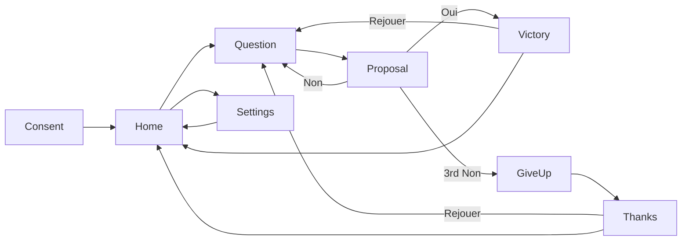

# PRD: Devine l'Animal

Status: approved
Project slug: guess-animal
Final app name: Devine l'Animal
Android package: io.github.nhilaire.guessanimal
Version target: 0.2.0
Last updated: 2026-10-12

> Written in English. Player-facing French copy is quoted in the "French copy" section.
> Status becomes `approved` only after the user explicitly approves this document.

## Summary

A family guessing game: the player thinks of an animal among about 225 well-known ones, and the app finds it by
asking yes/no questions, shown on screen and read aloud by a natural French voice. The fun is the "how did it
know?" moment, and trying to trip it up with another animal. Each question is the one that best splits the animals
still possible, and the game tolerates a wrong answer. Pitch: « Salut ! Je vais lire dans tes pensées. Pense à un animal… »

## Target players

- Families: children from about 6 years old (reading not required thanks to the voice) with or without an adult.
- Played on the couch or in the car, phone held or passed around; one hand is enough.
- Session: one game takes 1-3 minutes (at most about 20 questions); several games in a row.
- Accessibility: large buttons, large text, every question spoken, colour is never the only cue.

## Core loop

1. The player thinks of an animal and taps « Jouer ».
2. The game shows and speaks a question; the player answers Oui / Non / Je ne sais pas.
3. Repeat until the game is confident, then it proposes « J'ai trouvé ! C'est la girafe ? ».
4. Correct → victory screen; wrong → the game discards that animal and keeps asking; after 3 wrong proposals it gives
   up and asks which animal it was.
5. « Rejouer »: try another animal, or one the game will not find.

## Use cases

| ID | As a player I want to... | So that... |
|---|---|---|
| UC-01 | choose whether to share anonymous statistics at first launch | my privacy is respected |
| UC-02 | start a game and answer questions with three big buttons | I can play without reading or typing |
| UC-03 | hear each question read aloud and replay it | a child who cannot read can play |
| UC-04 | undo my last answer | a mis-tap does not spoil the game |
| UC-05 | have the game propose my animal and confirm or deny it | I see whether it guessed right |
| UC-06 | tell the game which animal I had in mind when it gives up | the game's gaps are known |
| UC-07 | play again right away | I can try to trip it up |
| UC-08 | turn sound, vibrations and statistics on or off | the game fits the moment and my choices |

## Screens

- **Consent** (first launch only): explains the anonymous statistics; « Accepter » and « Refuser » equally visible.
- **Home**: title, pitch « Salut ! Je vais lire dans tes pensées. Pense à un animal… », buttons « Jouer » and « Paramètres ».
- **Question** (game): counter « Question 3 », the question text (large), buttons « Oui », « Non »,
  « Je ne sais pas »; secondary buttons « Réécouter » and « Revenir » (« Revenir » disabled before the first answer).
  Android back returns to Home (the game is abandoned).
- **Proposal**: animal emoji (large) and « J'ai trouvé ! C'est la girafe ? », buttons « Oui » and « Non ».
- **Victory**: emoji, « Youpi, je suis trop fort ! », « C'était la girafe. », « En 12 questions. », buttons « Rejouer » and
  « Accueil ».
- **Give up**: « Bravo, tu es très fort ! », « À quel animal pensais-tu ? », alphabetical scrollable list of all
  animals (emoji + display name) and a last entry « Il n'est pas dans la liste ».
- **Thanks** (after Give up): « Merci ! Je ferai mieux la prochaine fois. », buttons « Rejouer » and « Accueil ».
- **Settings**: toggles « Son » (voice and effects), « Vibrations », « Statistiques anonymes »; back to Home.

## Rules and scoring

### Data

- About 225 animals (between 215 and 235, v0.2.0; 146 in v0.1), one readable source file (`data/animals.csv`, one row per animal, one
  column per question), converted into typed TypeScript by a script with tests. Questions in `data/questions.csv`.
- Each animal has: `id` (lowercase ASCII snake_case, e.g. `polar_bear`), French spoken name with article
  (« l'ours polaire », « la girafe »), display name (« Ours polaire »), emoji (fallback 🐾).
- No generic animal (no « Poisson », « Singe », « Serpent », « Oiseau », « Insecte »).
- About 40-60 questions, French, « tu » tone, about the animal (« Est-ce qu'il vit dans l'eau ? »).
  Amendment 2026-10-11: 89 questions are used (extra discriminating questions such as « barbichette », « défenses »,
  « moustaches » are needed so that every pair of close animals differs on 2 questions, AC-04); a game still asks
  about 8-12 of them. From v0.2.0: 110-120 questions.
- Each fact (animal × question) is `yes`, `no` or `variable` (true only for some individuals or contexts, or
  debatable for a child).
- A review sheet (`docs/DATA-REVIEW.md`, generated from the CSV) lets the user check animals one by one.

### Inference

- Each animal still in play has a weight, initially equal. A discarded animal has weight 0.
- Answer likelihoods: fact `yes` → P(Oui) = 0.90; fact `no` → P(Oui) = 0.10; fact `variable` → P(Oui) = 0.5;
  P(Non) = 1 − P(Oui). After Oui / Non, each weight is multiplied by the likelihood of the answer, then all weights
  are normalised to sum 1. « Je ne sais pas » changes no weight. So a contradicting answer divides an animal's weight
  by 9 relative to a matching one, without eliminating it (v0.2.0: 0.90 instead of 0.95, more tolerant of answers
  a child gives differently from the data).
- Next question: among questions not yet asked (a question answered « Je ne sais pas » counts as asked and is never
  asked again), ranked by expected information gain on the current weights (entropy before minus expected entropy
  after Oui / Non). Variety (v0.2.0): the candidates are the unasked questions whose gain is ≥ 50 % of the best gain,
  keeping at most the 6 best (user choice 2026-10-13, was 85 % / 3: more varied games for about 1 more question); the question is drawn uniformly among them with the game's random generator (seeded
  per game, injected so that tests are reproducible). Candidates are ranked by gain, ties broken by the earlier
  position in `data/questions.csv`, compared with 0.5 × best gain without rounding. In variety mode a new seed is
  taken from Math.random at each game start (Jouer / Rejouer). The generator state is part of the game state: undo
  restores it and it survives background / resume. In deterministic mode (tests and e2e flows) the best question
  is taken, ties going to the earliest question in the data file. Opening the deep link `guessanimal://deterministic`
  sets an in-memory flag (not saved, cleared when the app is killed), works in debug and release builds and opens
  the normal first screen; all e2e flows (AC-14 to AC-18, AC-22, AC-23, AC-33) open it first.
- Proposal: the game proposes the animal with the highest weight (ties: earliest in the data file) when (a) that
  weight ≥ 0.85, or (b) 20 questions have been answered (Oui, Non and Je ne sais pas all count), or (c) no unasked
  question has an expected information gain > 0.01 bit.
- After a wrong proposal the animal is discarded, weights are renormalised and the game asks at least 3 more
  questions before it may propose again (unless no unasked question gains > 0.01 bit); the question cap grows by 5
  per wrong proposal (20, then 25, then 30), so two proposals never follow each other while questions remain.
- The game gives up after the 3rd wrong proposal, or if every animal is discarded.
- Undo (« Revenir »): restores the exact state before the last answer to a question (weights, asked questions,
  counter). It can be repeated back to the first question. It does not undo a proposal answer: after a wrong
  proposal, undo goes back at most to the first question asked after that proposal.
- Interruption: if the app goes to background and comes back, the current game continues where it was; if the app
  is killed, the game is lost (no save) and the app opens on Home.
- The engine is pure TypeScript, independent of React Native. Its only randomness is the injected seeded generator,
  so a given seed and answer sequence always gives the same game.

### Quality targets (proved by simulation tests on the real data)

- Perfect player (Oui for `yes`, Non for `no`, Je ne sais pas for `variable`): every animal is found on the first
  proposal, within 20 questions; average over all animals ≤ 15 questions; in deterministic mode and with 5 fixed
  seeds in variety mode, each mode meeting the targets.
- Player making one wrong answer (deterministic mode, and with the same 5 fixed seeds in variety mode): for each animal, take the perfect player's path; for each of its first
  min(10, number of Oui/Non answers) Oui/Non answers, play one case where only that answer is inverted (« Je ne sais
  pas » answers are never inverted and the player stays perfect afterwards). The animal is found within 3 proposals
  in ≥ 90 % of all cases.
- Data distinguishability: every pair of animals differs on at least 2 questions where one is `yes` and the other
  `no`.

### Persistence

- Saved locally: consent choice and settings (sound, vibrations, statistics). No score, no history, no account.

## Look, sound and feel

- Style: bright, friendly flat colours, large rounded buttons (Oui green with ✓, Non red with ✗, Je ne sais pas grey
  with ?): icon and text together, never colour alone. Large readable font. Portrait only.
- Animals: Unicode emoji + French display name; 🐾 when no emoji fits. No copyrighted images.
- Voice: every question, every proposal sentence (« J'ai trouvé ! C'est la girafe ? ») and the fixed sentences (pitch,
  victory, give up, list prompt, thanks) are pre-recorded audio files with the fr-FR-DeniseNeural voice from Azure Speech
  (free tier F0, REST API). They are generated once by a local script, committed in the
  repository, bundled in the APK and played offline; the app never calls any speech service. The spoken text equals
  the French copy. Format: mono MP3, 48 kbit/s (about 225 proposals + 115 questions + 5 sentences, about 345 clips, ≈ 6.5 MB).
- Azure key and region are read by the generation script from user environment variables (AZURE_SPEECH_KEY,
  AZURE_SPEECH_REGION), never written in any repository. Amendment 2026-10-11, decided by the user: the Edge
  read-aloud service first chosen refused connections (HTTP 403), so the fallback Azure Speech is used.
- Playback: the question audio plays automatically when the question appears (if sound is on); « Réécouter » replays
  it; any answer stops the current audio. The proposal sentence plays when the Proposal screen appears.
- Sound effects: short victory jingle and short give-up sound, CC0 or self-generated; no background music.
- Haptics: short vibration on victory and on give-up (if vibrations are on).
- Animations: minimal (fade between questions, small bounce of the emoji on victory).

## Telemetry events

Only events listed here may be sent (after consent). Params: numbers, booleans or short enums. No identifiers.

| Event | When | Params | Feeds KPI |
|---|---|---|---|
| game_start | a game starts (Jouer / Rejouer) | none | Games per session |
| game_end | a game ends | result (found / given_up / quit), questions (int), wrong_guesses (int 0-3) | Guess success rate, Questions to find |
| animal_missed | the player picks an entry on the Give up screen | animal (fixed animal id from the data, or `not_listed`) | Missed animals |

App opens come from the automatic `session_start` / `first_open` events once consent is given. `quit` = back to
Home during a game.

## KPIs

Business and technical indicators followed in Firebase (free Spark plan). Details and console paths in `docs/KPIS.md`.

| KPI | Type | Target | Source |
|---|---|---|---|
| Guess success rate | business | ≥ 80 % of finished games | `game_end` result=found / (found + given_up) |
| Questions to find | business | median ≤ 15 | `game_end` questions where result=found |
| Missed animals | business | top list, used to fix the data | `animal_missed` by `animal` |
| Games per session | business | ≥ 2 | `game_start` / `session_start` |
| App opens (DAU) | business | followed, no target | Analytics > Engagement overview |
| D1 retention | business | ≥ 20 % | Analytics > Retention |
| Crash-free users | technical | ≥ 99 % | Crashlytics |

## Non-functional requirements

- Performance: smooth on a mid-range Android phone, cold start < 3 s, next question shown < 100 ms after an answer.
- APK size (arm64): < 45 MB (decimal: 45 000 000 bytes), audio included. Raised from 40 MB by the user on 2026-10-13
  (v0.2.0 arm64 APK: 40 426 388 bytes) to keep voice quality and room for more animals.
- Works fully offline (airplane mode): every screen and every audio file. No account. No ads.
- Permissions: no microphone (RECORD_AUDIO), no AD_ID; only what the stack and opt-in telemetry need.
- Android: minSdk from the stack defaults; portrait only.
- Privacy: opt-in telemetry, no personal data.

## Acceptance criteria

- AC-01 [e2e] Given a first launch, when the app opens, then the consent screen is shown in French with « Accepter »
  and « Refuser ».
- AC-02 [e2e] Given the consent screen, when the player taps « Refuser », then Home is shown and the consent screen
  does not appear at the next launch.
- AC-03 [unit] Given the animal data, when it is validated, then every animal has a fact for every question, ids and
  names are unique, ids are lowercase ASCII snake_case, every animal has an emoji (or 🐾) and a spoken name, and the
  count is between 215 and 235, and the question count is between 110 and 120.
- AC-04 [unit] Given the animal data, when every pair of animals is compared, then each pair differs on at least 2
  questions with one `yes` and the other `no`.
- AC-05 [unit] Given the animal data, then none of « Poisson », « Singe », « Serpent », « Oiseau », « Insecte » is an
  animal.
- AC-06 [unit] Given weights and an answer Oui or Non, when it is applied, then each weight is multiplied by 0.90,
  0.10 or 0.5 according to the fact and weights are renormalised; « Je ne sais pas » leaves weights unchanged.
- AC-07 [unit] Given a state in deterministic mode, when the next question is chosen, then it is the unasked question
  with the highest expected information gain, ties going to the earliest question in the data; a question answered
  « Je ne sais pas » is never chosen again (in any mode).
- AC-31 [unit] Given a state in variety mode, when the next question is chosen, then it is one of at most 6 unasked
  questions whose gain is ≥ 50 % of the best; the same seed gives the same game; over 20 seeds the opening question
  takes at least 4 different values.
- AC-08 [unit] Given a state with no wrong proposal yet, when the top weight is ≥ 0.85, or 20 questions are answered,
  or no question gains > 0.01 bit, then the engine proposes the top animal; otherwise it asks a question.
- AC-09 [unit] Given a wrong proposal, when « Non » is answered, then the animal is discarded and the game continues
  with at least 3 questions before the next proposal (unless no question gains > 0.01 bit) and a cap of 20 + 5 per
  wrong proposal; after the 3rd wrong proposal or when no animal remains, the game gives up.
- AC-34 [unit] Given the real data and a player whose Oui / Non answers are each flipped with probability 0.1 (fixed
  seed, 2 games per animal), when all games are played, then the animal is found within 3 proposals in ≥ 93 % of the
  games and no game shows two proposals in a row while an informative question remains.
- AC-10 [unit] Given answered questions, when undo is applied, then the state equals the state before the last
  answer, generator state included; undo is a no-op at the start and never crosses a proposal.
- AC-11 [unit] Given the real data and a perfect player, when each animal is played in deterministic mode and with
  5 fixed seeds in variety mode, then it is found on the first proposal within 20 questions, with an average ≤ 15
  questions in each mode.
- AC-12 [unit] Given the real data and the one-wrong-answer cases defined in "Quality targets", when all cases are
  played (deterministic mode and the 5 fixed seeds of variety mode), then the animal is found within 3 proposals in
  ≥ 90 % of the cases in each mode.
- AC-13 [unit] Given the data and the audio manifest, then every question, every animal proposal sentence and every
  fixed sentence has a bundled audio file, and each manifest text equals the French copy / data text.
- AC-14 [e2e] Given Home, when the player taps « Jouer », then a question is shown with « Question 1 » and the
  buttons « Oui », « Non », « Je ne sais pas », « Réécouter », « Revenir ».
- AC-15 [e2e] Given a game, when the player answers the questions consistently with « Lion », then the Proposal
  screen asks « J'ai trouvé ! C'est le lion ? » and « Oui » leads to the Victory screen with « Youpi, je suis trop fort ! ».
- AC-16 [e2e] Given a game, when the player answers « Non » to 3 proposals, then the Give up screen shows « Bravo, tu
  es très fort ! » and the animal
  list with « Il n'est pas dans la liste », and choosing an entry leads to the Thanks screen.
- AC-17 [e2e] Given the Question screen after one answer, when the player taps « Revenir », then the counter goes
  back to « Question 1 » and the first question is shown again.
- AC-18 [e2e] Given Settings, when « Son », « Vibrations » or « Statistiques anonymes » is toggled and the app is
  restarted, then each toggle keeps its value.
- AC-19 [unit] Given sound on, when a question or proposal appears or « Réécouter » is tapped, then its audio file is
  played and an answer stops it; given sound off, no audio is played.
- AC-20 [unit] Given the game flow, when a game starts, ends (found / given_up / quit) or an entry is picked on the
  Give up screen, then `game_start`, `game_end` and `animal_missed` are logged with exactly the params of the
  telemetry table.
- AC-21 [unit] Given consent refused or statistics turned off, when events are logged, then nothing is sent.
- AC-22 [device] Given consent accepted on the emulator, when a game is played to the end, then `game_start` and
  `game_end` appear in logcat with no identifier.
- AC-23 [device] Given the release APK, when its manifest is inspected, then it has neither RECORD_AUDIO nor AD_ID
  permission and the arm64 release APK is < 45 000 000 bytes; when the app is played in airplane mode, every e2e flow passes.
- AC-24 [device] Given the release APK on the emulator, when it is cold started, then the first screen is shown in
  < 3 s, and no crash appears in logcat during the e2e flows.
- AC-25 [unit] Given a game in progress, when the app goes to background and comes back, then the same question and
  counter are shown (and the next draws are unchanged).
- AC-32 [unit] Given the real data at the start of a game, when the next question is chosen, then it takes < 100 ms
  (median of 20 runs).
- AC-33 [e2e] Given the app opened through `guessanimal://deterministic`, when two games are answered the same way,
  then they show the same question sequence.
- AC-26 [unit] Given sound on, when the game reaches Victory or Give up, then the matching effect plays; given sound
  off, none plays. Given vibrations on, a short vibration fires on Victory and on Give up; given vibrations off, none
  fires.
- AC-27 [unit] Given `src/i18n/fr.ts`, the question texts and the audio manifest texts, then every « ! ? : ; » is
  preceded by a no-break space (U+00A0 or U+202F) and every « » encloses its text with no-break spaces.
- AC-28 [manual] Given a few sample sentences generated with fr-FR-DeniseNeural and 2 other French Azure voices, when
  the user listens to them, then the user confirms the voice before all audio files are generated.
- AC-29 [manual] Given the data review sheet, when the user reviews at least 30 animals across all questions (from
  v0.2.0: at least 30 of the new animals, with all questions including the new ones; new animals and questions are
  marked in docs/DATA-REVIEW.md, and the independent fact-check findings are recorded in docs/DATA-FACTCHECK.md with
  their corrections applied before the review).
  User decision 2026-10-13 for v0.2.0: the sheet review of the new animals is replaced by the user playing the new
  animals on the phone during the release test (AC-29 is then proven together with AC-30). Then
  every correction is applied and the user confirms the data are right.
- AC-30 [manual] Given the release APK on the user's phone, when a game is played with sound on, then the voice is
  natural and intelligible and the game is fun for the family.

## French copy

Tone: tu. French typography: no-break space before « : ; ! ? » and inside « ».

| Key | French text |
|---|---|
| consent.title | Statistiques anonymes |
| consent.body | Pour améliorer le jeu, Devine l'Animal peut envoyer des statistiques anonymes (parties jouées, animaux trouvés ou non, plantages). Aucune donnée personnelle. Tu peux changer d'avis dans les paramètres. |
| consent.accept | Accepter |
| consent.refuse | Refuser |
| home.pitch | Salut ! Je vais lire dans tes pensées. Pense à un animal… |
| home.play | Jouer |
| home.settings | Paramètres |
| game.counter | Question {n} |
| game.yes | Oui |
| game.no | Non |
| game.dontKnow | Je ne sais pas |
| game.replay | Réécouter |
| game.undo | Revenir |
| proposal.question | J'ai trouvé ! C'est {animal} ? |
| victory.title | Youpi, je suis trop fort ! |
| victory.body | C'était {animal}. |
| victory.questions | En {n} questions. |
| giveup.title | Bravo, tu es très fort ! |
| giveup.body | À quel animal pensais-tu ? |
| giveup.notListed | Il n'est pas dans la liste |
| thanks.body | Merci ! Je ferai mieux la prochaine fois. |
| common.playAgain | Rejouer |
| common.home | Accueil |
| settings.title | Paramètres |
| settings.sound | Son |
| settings.vibrations | Vibrations |
| settings.stats | Statistiques anonymes |

`{animal}` is the spoken name with article (« la girafe »); `{n}` is a number.

Amendment 2026-10-12 (user phone test, decided by the user): more playful copy. Pitch « Salut ! Je vais lire dans tes pensées. Pense à un animal… »,
proposal « J'ai trouvé ! C'est {animal} ? », victory title « Je le savais ! ». Proposal threshold kept at 0.85
(simulation: 0.70 saves under 1 question but drops right-first-time proposals from 90 % to 69 % with one wrong answer).
Screens keep their buttons clear of the Android navigation bar (safe-area bottom inset).

Amendment 2026-10-12, version 0.1.1 (requested by the user after release 0.1.0): victory title « Youpi, je suis trop fort ! » (was
« Je le savais ! »); give-up title « Bravo, tu es très fort ! » (was « Je donne ma langue au chat ! »), followed by
« À quel animal pensais-tu ? ». Both are spoken. Version 0.1.1 was verified but not released; it ships in 0.2.0.

Amendment 2026-10-13, version 0.2.0 (after the user's phone test: several animals proposed in a row, e.g. coq →
moineau → flamant rose): at least 3 questions after a wrong proposal, question cap 20 + 5 per wrong proposal, answer
likelihood 0.90 instead of 0.95 (user choice "1 + 2"; proposal threshold kept at 0.85). Simulation with 10 % wrong
answers: found 87.7 % → 95.8 %, first proposal right 73.7 % → 83.0 %, about 2 more questions, no proposals in a row.
Trap facts (correct but often answered the other way by children, e.g. the rooster does not lay eggs) are reviewed
by an agent and set to variable when the 2-difference rule (AC-04) still holds.

Amendment 2026-10-12, version 0.2.0 (requested by the user): more variety and more animals.
- About 225 animals (215-235, about 80 new ones well known to children; no generic animal, no dinosaur; the user
  chose 225 well-known animals over 250 with lesser-known species on 2026-10-12); about 20-30 new
  questions (110-120 in total) so that the new animals stay distinguishable (AC-04 unchanged: 2 strong differences).
- Games vary: the next question is drawn among the best questions (rule in "Inference"); AC-07 now applies to the
  deterministic mode used by tests and e2e flows, AC-31 covers the variety mode, AC-11 is checked in both modes.
- The new animals and questions get a fact-check by an independent agent, then a review by the user of at least 30 of
  the new animals (AC-29 applies to them); the voice clips of new questions and proposals are generated with the
  same voice (AC-28 unchanged).

## Out of scope

- Learning new animals or questions from players.
- Languages other than French.
- Speech recognition / microphone.
- Multiplayer, leaderboards, scores, accounts, ads, in-app purchases.
- Animal illustrations or photos (emoji only).
- A list-of-animals screen outside the Give up screen; an end-of-game recap of questions and answers.
- Calling any text-to-speech service from the app; saving a game in progress when the app is killed.

## Open questions

None
